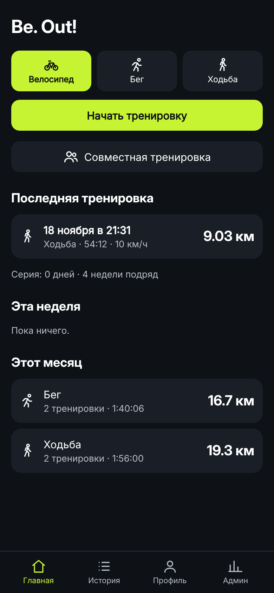
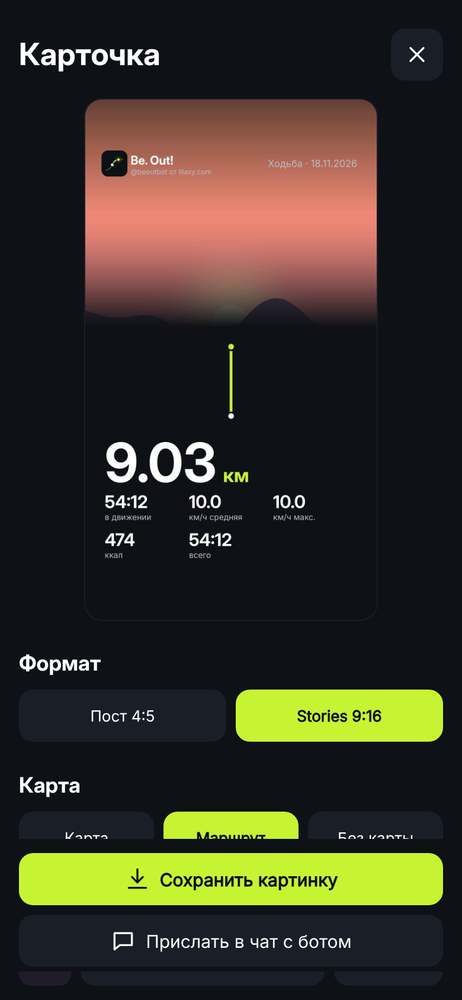
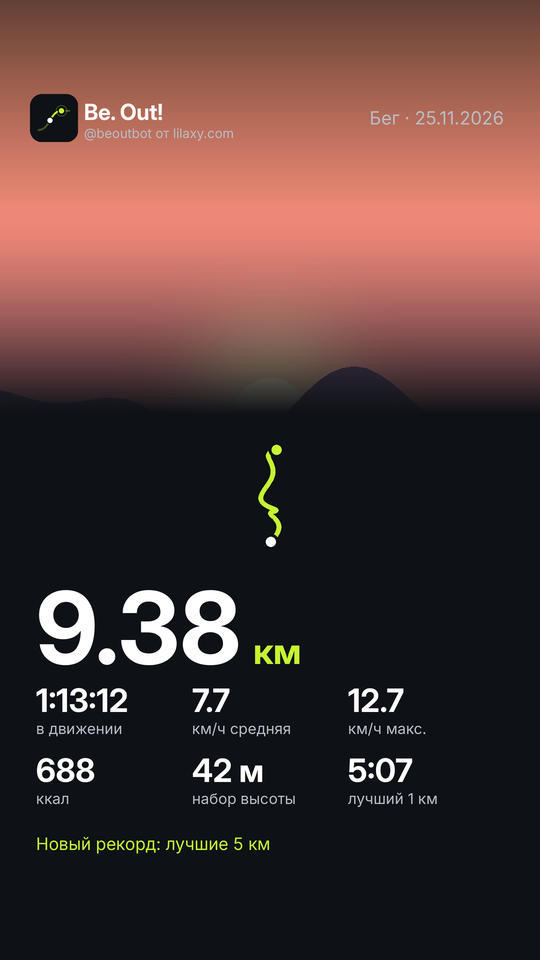
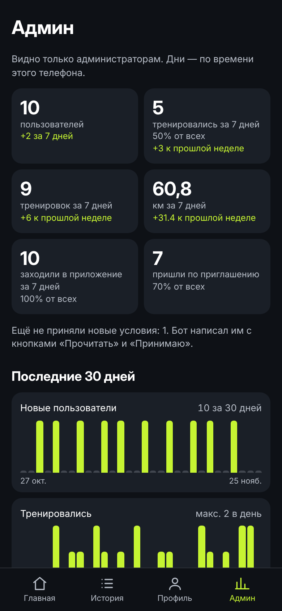

# Be. Out!

[](https://github.com/qlarens/beout/actions/workflows/ci.yml)
[](LICENSE)


Трекер тренировок в Telegram — велосипед, бег, ходьба. Бот записывает тренировку через «Трансляцию геопозиции» (даже с заблокированным экраном), Mini App показывает маршрут, статистику и делает карточки для чатов и Instagram.

<p>
  
  
  
  
</p>

## Возможности

- **Запись:** 📎 → «Геопозиция» → «Транслировать». Финиш — кнопкой, `/stop` или сам через 2 часа без точек.
- **Статистика:** дистанция, время, скорость, сплиты, калории, набор высоты, рекорды, серии, итоги недели и месяца.
- **Карточки:** пост 4:5 или Stories 1080×1920; карта, только маршрут или без карты; своё фото на фоне; выбор цифр.
- **Вместе:** совместные тренировки на одной карте, рейтинг в группах (`/top`), приглашения друзей, SOS-контакты.
- **Админ:** вкладка со статистикой роста, воронкой, удержанием и приглашениями — для ID из `ADMIN_CHAT_ID`.
- **Данные:** ничего не пишется до согласия; `/export` и `/delete`. Языки: русский, украинский, английский.

## Запуск

```bash
pip install -r requirements.txt
cloudflared tunnel --url http://localhost:8080   # Mini App нужен HTTPS
BOT_TOKEN="123456:ABC..." WEBAPP_URL="https://xxxx.trycloudflare.com" python bot.py
python -m unittest tests                         # тесты
```

В @BotFather: **Bot Settings → Configure Mini App → Main Mini App** = `WEBAPP_URL`.

| Переменная | Зачем |
|---|---|
| `BOT_TOKEN`, `WEBAPP_URL` | обязательные |
| `DB_PATH`, `BACKUP_DIR` | база (`beout.db`) и ежедневные копии за 7 дней |
| `ADMIN_CHAT_ID` | ID администраторов через запятую: уведомления, `/invites`, вкладка «Админ» |
| `DEV_USER_ID` | локальная отладка без Telegram — не на сервере |

## Прод

VDS, systemd: `beout` (бот на `127.0.0.1:8090`) и `beout-tunnel` (Cloudflare → `https://beout.lilaxy.com`). Каждый push в `master` после зелёных тестов выкладывается сам ([ci.yml](.github/workflows/ci.yml) → [deploy/beout-deploy](deploy/beout-deploy)), а если бот не поднялся — релиз откатывается. Новый сервер: `sudo bash deploy/setup-vds.sh "<ключ деплоя>"`. Секреты — `/etc/beout/`, логи — `journalctl -u beout`.

## Важно

- **Условия:** [webapp/privacy.html](webapp/privacy.html) (+ `.uk`, `.en`). Поменял — поправь все три, тексты «что нового» и подними `POLICY_VERSION` в `bot.py`: бот сам попросит всех принять заново.
- **Версии:** [CHANGELOG.md](CHANGELOG.md), текущая — `APP_VERSION` в `settings.py`.
- **План:** [docs/ROADMAP.md](docs/ROADMAP.md).
